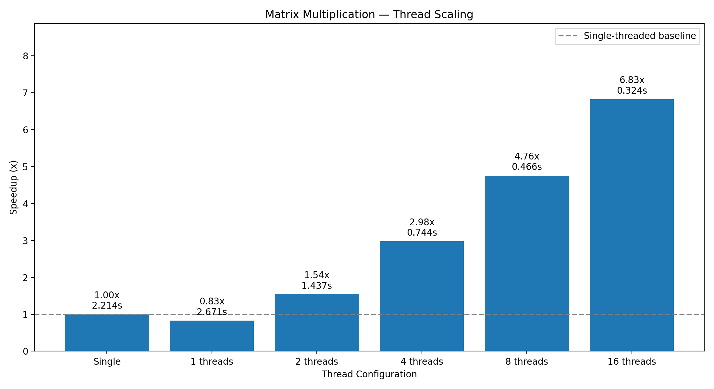

# TCES 420 — Project #2: Threading Introduction

## Overview

This project explores parallel computing using POSIX threads (`pthreads`) in C. It implements both single-threaded and multithreaded matrix multiplication and compares their execution performance.

The objective is to measure how increasing the number of threads affects execution time and computational speedup.

## Implementation

### Single-Threaded Multiplication

The single-threaded implementation uses the standard \(O(N^3)\) matrix multiplication algorithm. Each element of the resulting matrix is calculated by computing the dot product of a row from matrix A and a column from matrix B.

### Multithreaded Multiplication

The multithreaded implementation uses POSIX threads and **cyclic row decomposition**. Each thread processes a subset of rows according to its thread index and the total number of threads.

For example, with four threads:

- Thread 0: Rows 0, 4, 8, 12, ...
- Thread 1: Rows 1, 5, 9, 13, ...
- Thread 2: Rows 2, 6, 10, 14, ...
- Thread 3: Rows 3, 7, 11, 15, ...

Each thread writes exclusively to its assigned rows in the output matrix. Consequently, no mutexes or other locking mechanisms are required.

This decomposition was chosen because it is simple to implement and distributes the work approximately evenly among threads, even when the matrix size is not evenly divisible by the thread count.

## Building and Running

### Requirements

- C11-compatible compiler (GCC or Clang)
- POSIX threads
- GNU Make
- Python 3
- Matplotlib

### Compilation

```bash
make
```

### Single-Threaded Execution

```bash
./build/single
```

### Multithreaded Execution

Specify the number of threads as a command-line argument:

```bash
./build/multi 4
```

Supported benchmark configurations include 1, 2, 4, 8, and 16 threads.

## Benchmarking

A Python benchmarking script automates performance testing.

```bash
python3 -m pip install matplotlib
python3 scripts/benchmark.py
```

The benchmark:

1. Runs the single-threaded implementation as a baseline.
2. Tests the multithreaded implementation with 1, 2, 4, 8, and 16 threads.
3. Repeats each configuration three times.
4. Calculates median execution times.
5. Calculates speedup relative to the single-threaded baseline.
6. Displays and saves a performance bar chart.

Speedup is calculated as:

**Speedup = Single-threaded execution time / Multithreaded execution time**

Results are saved in:

- `results/benchmark.csv` — Numerical results
- `results/speedup.png` — Performance bar chart

### Testing Environment

- **Machine:** Apple MacBook Pro (Mac17,9)
- **Processor:** Apple M5 Pro
- **Physical CPU Cores:** 15 (5 Super + 10 Performance)
- **Logical CPUs:** 15
- **SMT/Hyper-Threading:** No, Apple Silicon does not use SMT.
- **Memory:** 24 GB
- **Operating System:** macOS 27.0.1
- **Matrix Dimensions:** 2000 × 2000
- **Compiler:** GCC command (`gcc`)
- **Compiler Optimizations:** `-O2`
- **Compilation Standard:** C11
- **Threading Library:** POSIX Threads (`pthreads`)

### Performance Results



Numerical timing and speedup results are available in `results/benchmark.csv`.


## Analysis

### Potential Performance Improvements

There are several ways performance could potentially be improved. One approach would be to use a more efficient matrix multiplication algorithm.

For this assignment, I chose the standard naive matrix multiplication algorithm because the primary objective was to explore multithreading rather than optimize the underlying mathematical algorithm.

[Wikipedia's article on matrix multiplication algorithms](https://en.wikipedia.org/wiki/Matrix_multiplication_algorithm) discusses several possible improvements, including cache optimization and memory access patterns.

I did not explicitly optimize memory access patterns when writing the code, and I do not yet have enough experience with CPU cache behavior to confidently implement these optimizations. However, reducing cache misses would likely be an important area for improvement.

Another possibility would be experimenting with different decomposition techniques, such as assigning consecutive blocks of rows rather than interleaving them between threads.

### Implementation Challenges

Memory management in C was one of the more challenging aspects of this project.

I have a decent amount of experience with memory management in C++, but modern C++ provides many quality-of-life features that are not available in C11, such as smart pointers and RAII.

I also found working with `void *` pointers somewhat unintuitive, particularly when passing arguments to pthread worker functions. Since `pthread_create()` accepts only one generic pointer argument, I had to organize the necessary information into a structure and manage its lifetime carefully.

Setting up the thread creation loop took some additional effort, particularly ensuring that each thread received the correct arguments and that the allocated memory remained valid until the threads finished executing.

Overall, the project provided useful experience working with pointers, dynamic memory allocation, and concurrency in C.

### Team Contributions

This project was completed individually.

I implemented the core C matrix multiplication algorithms and POSIX threading functionality. ChatGPT generated the Python benchmarking and visualization script.

The benchmarking script generates the graph on demand, so the experiments can be reproduced by running it.

## Conclusion

Looking at the performance graph, eight threads appear to offer the best balance between performance improvement and the number of threads used.

The graph demonstrates diminishing returns as additional threads are introduced. While increasing the thread count initially produces significant improvements, the benefits eventually become smaller.

Interestingly, using only one worker thread appears to be slower than the original single-threaded implementation. This is likely due in part to the overhead associated with creating and joining a pthread.

With only one worker thread, that thread performs all the matrix multiplication while the main thread waits for it to finish. Consequently, we introduce additional thread-management overhead without gaining any parallel computational benefit.

Overall, I learned a lot about C programming through this project. It was useful to gain more experience with the more complicated aspects of C memory management and concurrency, particularly compared to the abstractions available in modern C++.